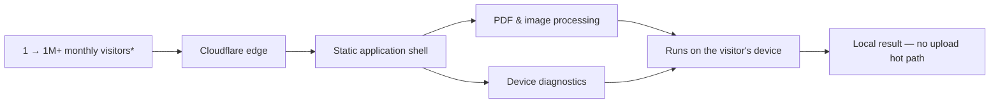

<div align="center">
  
</div>

<div align="center">
  <a href="https://shakti-portfolio-xi.vercel.app">
    
  </a>
  <a href="https://linkedin.com/in/shaktiram22">
    
  </a>
  <a href="mailto:shaktiram.lucifer@gmail.com">
    
  </a>
  <a href="https://pdfforfree.in/">
    
  </a>
</div>

<div align="center">
  
</div>

<p align="center">
  <strong>SDE I / SDE II-focused engineer building reliable AI products, scalable backend systems, and search-ready web platforms.</strong>
</p>

## Engineering beyond the demo

I build the parts that make software dependable after the happy path: tenant boundaries, background delivery, idempotency, failure recovery, local-first privacy, measurable performance, and release verification.

My current work sits at the intersection of:

- **GenAI and agent orchestration** — RAG, vector retrieval, tool-driven agents, OpenAI/Codex integration, OpenClaw workflows, delegation, validation, and approval gates.
- **Backend and distributed systems** — Node.js, Fastify, Express, Python, FastAPI, MongoDB, Redis Streams/Pub/Sub, SSE, RBAC, JWT, transactional outbox, and local SDK evaluation.
- **Observability and delivery** — OpenTelemetry, Prometheus, Grafana, structured logging, Docker, CI, load testing, and failure drills.
- **SEO and edge deployment** — Astro, structured data, canonical URLs, sitemaps, Core Web Vitals, PWA/offline behavior, CSP, and Cloudflare Pages.
- **Systems engineering** — Linux interfaces, Python CLI/GTK tooling, C++ networking, concurrency, sockets, and LRU caching.

> I prefer evidence over adjectives: tested failure modes, explicit security boundaries, reproducible benchmarks, and honest limitations.

## Current direction: approval-first AI orchestration

```text
Ask → Plan → Delegate → Execute → Validate → Deliver
```

I am exploring local AI mission-control systems where agents use typed tools, delegate bounded work, preserve durable task history, and pause before consequential actions. The focus is not just autonomous execution—it is controllable, inspectable execution.

<div align="center">
  
  
  
  
</div>

## Live product and selected engineering work

| Project | What it demonstrates | Core stack |
| --- | --- | --- |
| [**PDF for Free ↗**](https://pdfforfree.in/) | Live privacy-first product with 43 PDF and image tools; files stay in the browser instead of entering an upload pipeline | Astro, TypeScript, Web APIs, WebAssembly, Cloudflare |
| [**Northstar Feature Flag Platform**](https://github.com/Shaktiprasadram22/feature-flag-platform) | Multi-tenant control/data planes, deterministic rollouts, transactional outbox, Redis delivery, SSE, local SDK decisions, RBAC, observability, E2E and load tests | TypeScript, Fastify, MongoDB, Redis, React, OTel, Docker |
| [**DeviceLab**](https://github.com/Shaktiprasadram22/device-lab) | 30 private browser hardware tests, 9 guided inspections, local reports, offline PWA, accessible UX, and static edge deployment with no application backend | Astro, TypeScript, IndexedDB, Web APIs, Cloudflare Pages |
| [**TradeNexus**](https://github.com/Shaktiprasadram22/TradeNexus) | Multi-service AI product separating the React interface, Node data API, Python RAG API, and vector retrieval layer | React, Express, FastAPI, ChromaDB, OpenAI |
| [**ASUS TUF RGB**](https://github.com/Shaktiprasadram22/asus-tuf-rgb) | Dependency-free Linux hardware control through upstream kernel interfaces, safe session writes, verified profiles, GTK UI, and systemd integration | Python, GTK 4, Linux sysfs, systemd |
| [**UMS RAG Chatbot**](https://github.com/Shaktiprasadram22/Ums_chatbot_01) | University knowledge retrieval with semantic search and context-aware responses across a full-stack application | React, Express, Python, LangChain, FAISS, OpenAI |
| [**Multi-threaded Proxy Server**](https://github.com/Shaktiprasadram22/MultiThreadedProxyServer) | Concurrent socket handling and a thread-safe LRU cache in a systems-level HTTP proxy | Modern C++, POSIX sockets, threads |
| [**SentinelDataCore**](https://github.com/Shaktiprasadram22/SentinelDataCore) | Authenticated REST APIs, bulk operations, role boundaries, persistence, and application-level caching | Node.js, Express, MongoDB, JWT |
| [**Cache Strategy Lab**](https://github.com/Shaktiprasadram22/System_Design_Cache) | Cache-aside versus eager pre-warming, TTL behavior, cache hits/misses, and database fallback made observable | Next.js, Redis, SQLite, TypeScript |
| [**Redis Queue System**](https://github.com/Shaktiprasadram22/Dockerized-Node.js-Redis-Queue-System) | Producer/consumer task processing with independently scalable workers and reproducible local infrastructure | Node.js, Redis, Docker Compose |

## Product scale and system-design lens

<div align="center">
  
  
  
</div>



| Product/system | Scale signal | System-design decision |
| --- | --- | --- |
| **PDF for Free** | **Architecture target: 1M+ monthly visitors\*** | Static edge delivery plus client-side processing avoids per-document application-server work |
| **DeviceLab** | **Architecture target: 1M+ monthly visitors\*** | Browser-local diagnostics and IndexedDB reports keep the core inspection path off a backend |
| **Northstar** | **Measured: 1,269,098 local evaluations/sec** | Control plane distributes configuration; SDKs evaluate flags locally without a network hop per decision |
| **Queue + cache labs** | **Horizontally scalable design; not load-tested** | Worker replicas absorb queued jobs; cache-aside/pre-warming reduce repeated database reads |
| **RAG applications** | **Scale-out design; not load-tested** | UI, API, retrieval, and generation are separate boundaries that can be cached, queued, and replicated independently |

\*Architecture target, not current traffic or a CDN load test. Cloudflare documents [free and unlimited static asset requests](https://developers.cloudflare.com/pages/functions/pricing/); real user experience still depends on asset size, browser capability, client memory, and third-party limits.

### Measured systems evidence

The Northstar platform includes reproducible local benchmarks—not production SLO claims:

- **1,269,098 local SDK evaluations/second** across a 1,000,000-evaluation run.
- **6.09 ms p95** for authenticated configuration reads.
- **254.27 ms p95** commit-to-local-SDK propagation after isolating a Redis blocking-connection bottleneck.

The repository includes the benchmark commands, host context, thresholds, failure scenarios, ADRs, and trade-offs behind those numbers.

## Toolbox

<div align="center">
  
  <br />
  
</div>

<br />

| Area | What I work with |
| --- | --- |
| **AI systems** | RAG pipelines, embeddings, vector search, prompt/tool contracts, agent routing, evaluation, approval-first orchestration |
| **Backend** | REST APIs, SSE, background jobs, caching, authentication, authorization, multi-tenancy, event delivery |
| **Reliability** | Idempotency, retry/DLQ, last-known-good state, health checks, metrics, traces, logs, load tests |
| **Web products** | React, Astro, accessible UI, browser APIs, IndexedDB, PWA, privacy-first client processing |
| **SEO and edge** | Crawlable static architecture, Schema.org, metadata, canonical/sitemap strategy, Cloudflare Pages, performance budgets |

## How I approach a system

```text
Correctness first
  ├── define ownership and trust boundaries
  ├── make failure and recovery explicit
  ├── measure the critical path
  ├── automate the release gate
  └── document what the system cannot guarantee
```

## GitHub activity

<div align="center">
  
</div>

<div align="center">
  
  
</div>

## Let’s build something real

I am interested in software engineering, GenAI/backend, platform, and AI-agent work where system design and implementation both matter.

<div align="center">
  <a href="mailto:shaktiram.lucifer@gmail.com">
    
  </a>
</div>

<div align="center">
  
</div>
